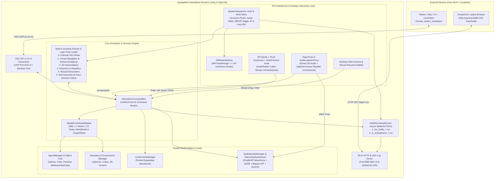

# SpatialMAS: Master Architecture & Single-Run AI Implementation Plan

> This is the original design plan, not a release or hardware-validation report. Current behavior, supported signatures, known platform limits, and local test commands are documented in `README.md` and `docs/`. In particular, full compatibility, performance targets, and visionOS integration remain subject to validation.

> [!IMPORTANT]
> **Commercial & IP Clean-Room Mandate ([Grant Qualification Project](file:///c:/Users/pitte/Documents/Repositories/spatialmas_unity/helping_sources/pedro-lucas-spatialMAS-qualification-project-2026.pdf))**  
> To ensure clean IP transfer and Freedom to Operate (FTO) with *Inven2* (UiO TTO), **SpatialMAS** must be implemented as a **100% standalone, clean-room proprietary architecture** in Unity 6 (`6000.6.6f1`). It must **not** copy the messy academic scripts or legacy `OculusIntegration` dependencies from [`human_swarm_ims`](file:///c:/Users/pitte/Documents/Repositories/spatialmas_unity/helping_sources/human_swarm_ims), while maintaining **100% protocol backward-compatibility** with the published [ACSOS 2025 OSC API](file:///c:/Users/pitte/Documents/Repositories/spatialmas_unity/helping_sources/ACSOS2025___Human_Swarm_IMS_Artifact_camera_ready-public-INCONFERENCE.pdf) so all scripts in [`human_swarm_examples`](file:///c:/Users/pitte/Documents/Repositories/spatialmas_unity/helping_sources/human_swarm_examples) work out of the box.

---

## 0. Confirmed Architectural Decisions Summary

All key product and engineering decisions have been locked in:
1. **Multiplatform XR & Desktop Architecture (Quest 3 + Apple Vision Pro + Generic OpenXR + Desktop)**:
   - Built on vendor-neutral **Unity 6 OpenXR + AR Foundation 6.6 + XR Interaction Toolkit (XRI) 3.6 + XR Hands 1.9 + Input System 1.20**, wrapped in a runtime **`XRPlatformAdapter`**:
     - **Meta Quest 3 / 3S / Pro (`Android` OpenXR)**: Native 90/120 Hz frame pacing, ARCameraManager underlay passthrough, and direct optical `XRHandSubsystem` pinch hysteresis.
     - **Apple Vision Pro (`visionOS`)**: Supports both Full Space Mixed/Immersive rendering and **Eye Gaze + Indirect Pinch (`<SpatialPointer>` / XRI Gaze-Pinch)** alongside direct `XRHandSubsystem` joint tracking.
     - **Generic OpenXR Headsets (Android XR, Pico 4 Ultra, HTC Vive, PCVR)**: Standard OpenXR hand tracking + 6DoF controller fallback.
     - **Desktop Standalone (`Windows`, `macOS`, `Linux`)**: WASD + Mouse Orbit camera & raycast grab/rotate rig.
2. **Default Audio Engine**: **Native C# Procedural DSP Synthesizer** (`OnAudioFilterRead` with PolyBLEP Sine/Square/Saw/Triangle + ADSR + Biquad LPF + Reverb) as the zero-dependency default across **Android ARM64 (Quest), visionOS ARM64 (Apple Vision Pro), Windows, macOS, and Linux**, behind an `IAgentAudioSynth` adapter so `CsoundUnity` remains an optional plug-in.
3. **Spatial Coordinate Scale & Arena Centering**: Configurable **World Scale multiplier** (e.g., `1.0x` Room-Scale vs `0.15x–0.20x` Tabletop/Arena Scale) and **Origin Offset** (defaulting to `(0f, 1.2f, 0.8f)` chest-height in front of the user, plus a two-handed grabbable World Anchor in XR).
4. **Embodied XR User Tracking**: The headset **Head position (`MainCamera`)** automatically drives the 3D `AudioListener` (with an option to detach/override via OSC) and optionally acts as a live **human agent/repeller** streamed over OSC (`/xr/user/pose` and `/xr/hands/pose`).
5. **Five Built-in No-Code Scenarios**:
   - **Scenario 1**: *Crowd Navigation & Human Avoidance* (Grant Proposal flagship behavioral psychology scenario)
   - **Scenario 2**: *3D Swarmalators* (Coupled spatial swarming & phase synchronization)
   - **Scenario 3**: *Orbital Attractors & Repellers* (Expanding wavefront local communication & emergent orbits)
   - **Scenario 4**: *Musical Encounters* (SysMus25 workshop interactive proximity sonification)
   - **Scenario 5**: *Self-Assembly* (ACSOS 2024 autonomous/interactive 6-face cubic structures with synchronized polyrhythmic musical phasors)
   - **Scenario 0**: *External OSC Controller Mode* (100% `HS-ims` compatible UDP transceiver)
6. **Dual CSV Logging + Wi-Fi HTTP/UDP Log Export Server**: Logs both **OSC traffic CSV** and **XR Embodiment Telemetry CSV** (Head 6DoF, Left/Right Hand 6DoF, pinch events, active agent count, frametime ms) and serves them via a built-in **HTTP Web Dashboard (`http://<headset-ip>:8080/`)** and optional live UDP stream so researchers can download CSV logs directly to their laptop browser over Wi-Fi without an `adb pull` cable or Xcode device container export.

---

## 1. What You Need Installed & Prepared on Your Computer

To allow an agentic AI (such as OpenAI GPT 6.1 Sol or Antigravity) to generate, wire, compile, and test the entire Unity project in **one single autonomous run** without manual Unity Inspector clicking:

### 1.1 Required Software & SDKs
1. **Unity 6 (`6000.6.6f1`)** via Unity Hub (matching [`ProjectVersion.txt`](file:///c:/Users/pitte/Documents/Repositories/spatialmas_unity/ProjectSettings/ProjectVersion.txt)):
   - **Android Build Support** module installed (with **Android SDK & NDK Tools** and **OpenJDK**).
   - **Windows Build Support (IL2CPP)** (or Mac/Linux Build Support as needed).
2. **Android Platform Tools (`adb`)** in your system `PATH` (for automated Quest 3 APK sideloading and logcat verification).
3. **.NET SDK 8.0+** & **Git** (with Git LFS for any binary assets).
4. **Python 3.11+** with `python-osc` and `numpy` installed (`pip install python-osc numpy`) so the AI agent can run automated end-to-end OSC verification against the Unity runtime.

### 1.2 Do You Need 3D Modelers (Blender, etc.) or External Audio Plugins?
* **3D Modeling Software (Blender/Maya): NOT Required.**
  - All core agent shapes (`Sphere`, `Cube`, `Pyramid`), `Arrow` indicators, `Boundaries` (`Sphere`, `Cube`), `SelfAssembly` 6-face connector cubes, `AudioListener` proxy, and `Spatial XR Menus` are generated **100% procedurally via C# Mesh/Primitive generators and URP materials** inside an Editor builder script (`SpatialMASEditorBuilder.cs`), following the proven pattern in [`MRPieceFactory.cs`](file:///c:/Users/pitte/Documents/Repositories/spatialmas_unity/helping_sources/laser-xr/Assets/Scripts/Tabletop/MRPieceFactory.cs) and [`MRSceneBuilder.cs`](file:///c:/Users/pitte/Documents/Repositories/spatialmas_unity/helping_sources/laser-xr/Assets/Scripts/Editor/MRSceneBuilder.cs).
  - **Why this is crucial for Token Optimization**: AI agents waste tens of thousands of tokens parsing `.fbx` metadata or hand-writing 10,000-line `.unity` YAML files. Generating prefabs, procedural meshes (including a 5-vertex/6-triangle Pyramid mesh and 3D Arrow mesh), materials, and scenes via a deterministic C# Editor script costs ~2,500 tokens and guarantees **zero broken GUID links**.
* **Audio Synthesis Plugins: NOT Required.**
  - Our built-in `NativeDspSynthesizer` runs natively in C# via `OnAudioFilterRead` with zero external `.dll`/`.so` dependencies.

---

## 2. Token-Optimal Strategy: How to Feed Context to the AI Agent

> [!CAUTION]
> **Do NOT let the AI agent scan `helping_sources/human_swarm_ims` during code generation.**  
> `human_swarm_ims` contains over 180 C# files from unrelated legacy projects (`XloopeR`, `HeartOscillators`, `SyncPhaseFreq`, `Oculus` SDK samples) and massive `.unity` YAML scenes. Letting an AI agent browse that folder will burn 150k+ tokens and pollute its context with deprecated Unity 2022 / Oculus SDK patterns.

### Step-by-Step Context Preparation Before Launching the AI Run:
1. **Move or Exclude `helping_sources/human_swarm_ims`**:
   - Either move `helping_sources/human_swarm_ims` outside the workspace before running the AI agent, or instruct the AI via the Master Prompt (Section 10 below) to **strictly ignore `helping_sources/human_swarm_ims`**.
2. **Keep Only Two Reference Inputs**:
   - **Input A**: This complete specification document (which already distills every OSC address, data type, coordinate formula, synth CC bug fix, and Self-Assembly state machine from `human_swarm_ims` and `human_swarm_examples`).
   - **Input B**: The 4 proven Unity 6 Quest 3 MR scripts in [`helping_sources/laser-xr/Assets/Scripts/MR/`](file:///c:/Users/pitte/Documents/Repositories/spatialmas_unity/helping_sources/laser-xr/Assets/Scripts/MR) (`MRPerformanceOptimizer.cs`, `MRHandSmoothingProcessor.cs`, `MRHandPinchHysteresis.cs`, `MRSimulatorAutoHand.cs`) and [`MRSceneBuilder.cs`](file:///c:/Users/pitte/Documents/Repositories/spatialmas_unity/helping_sources/laser-xr/Assets/Scripts/Editor/MRSceneBuilder.cs).

---

## 3. Diagnosis of `human_swarm_ims` Flaws & How `SpatialMAS` Fixes Them

| Subsystem | Legacy `human_swarm_ims` Implementation | Flaw / Hidden Bug Discovered | New `SpatialMAS` Commercial Implementation |
| :--- | :--- | :--- | :--- |
| **OSC Transport** | [`OSCServer.cs`](file:///c:/Users/pitte/Documents/Repositories/spatialmas_unity/helping_sources/human_swarm_ims/Assets/Scripts/External%20Communication/UnityOSC/OSC/OSCServer.cs) & [`OscManager.cs`](file:///c:/Users/pitte/Documents/Repositories/spatialmas_unity/helping_sources/human_swarm_ims/Assets/Scripts/External%20Communication/UnityOSC/OscManager.cs) | `Thread.Sleep(5)` in receive loop drops UDP packets when >249 audio agents update; un-synchronized `Queue<OSCPacket>` causes race conditions; `Thread.Abort()` throws `PlatformNotSupportedException` on IL2CPP/Android; heavy `List<object>` boxing per message. | **High-Throughput Async UDP Socket (`SpatialMAS.Networking`)**: Uses `Socket` with `CancellationToken`, 1 MB UDP receive buffer (`ReceiveBufferSize = 1048576`), lock-free `ConcurrentQueue<OscMessage>`, and pooled byte buffers. |
| **Synth CC ID Mismatch Bug** | [`CsoundBasicSynthesizer.cs`](file:///c:/Users/pitte/Documents/Repositories/spatialmas_unity/helping_sources/human_swarm_ims/Assets/Scripts/Utilities/SoundSynthesis/CsoundBasicSynthesizer.cs) vs [`MusicalSwarmalator.py`](file:///c:/Users/pitte/Documents/Repositories/spatialmas_unity/helping_sources/human_swarm_examples/python/swarmalators/MusicalSwarmalator.py) vs [`README.md`](file:///c:/Users/pitte/Documents/Repositories/spatialmas_unity/helping_sources/human_swarm_examples/README.md) | **Hidden Protocol Bug**: `README.md` Table 3.1 says `cc_id=0` is Oscillator Type, whereas `MusicalSwarmalator.py` and `CsoundBasicSynthesizer.cs` use `cc_id=1` (`oscillatorTypeId=1, presetId=0`). Also, Python examples send ADSR on `CC 82, 83, 85, 17`, whereas C# inspector defaults were `74, 71, 72, 73`! | **Dual-Compatible CC Router (`NativeDspSynthesizer`)**: Accepts **both** `0` and `1` for Waveform Type (when value $\in \{0..3\}$), and maps **both** `82/74` $\to$ Attack, `83/71` $\to$ Decay, `85/72` $\to$ Sustain, `17/73` $\to$ Release. Every legacy script works 100% reliably! |
| **Coordinate & Scale Mapping** | [`GenericExternalCommunicationManager.cs`](file:///c:/Users/pitte/Documents/Repositories/spatialmas_unity/helping_sources/human_swarm_ims/Assets/Scripts/External%20Communication/GenericExternalCommunicationManager.cs#L473-L483) | Hardcodes `1 mm = 0.001 m` with swapped `(X, Z, Y)` axes (`pos = new Vector3(x, z, y) * 0.001f`). Desktop scripts use boundary `radius = 10000` ($10\text{ m}$!), putting agents outside physical Quest 3 rooms and centering `(0,0,0)` on the floor. | **`SpatialCoordinateMapper`**: Preserves `(X, Z, Y)` mm wire format for 100% v1 OSC compatibility, while applying configurable **`WorldScale`** (`1.0x` Room-Scale, `0.2x` Tabletop Scale) and **`OriginOffset`** (`(0, 1.2m, 0.8m)` chest-height center + Two-Handed Grabbable World Anchor). |
| **Audio Synthesis** | [`CsoundBasicSynthesizer.cs`](file:///c:/Users/pitte/Documents/Repositories/spatialmas_unity/helping_sources/human_swarm_ims/Assets/Scripts/Utilities/SoundSynthesis/CsoundBasicSynthesizer.cs) | Spawns a heavy `CsoundUnity` instance per agent; clicks/pops at $\ge 24$ agents; no native Linux support. | **`NativeDspSynthesizer`**: Zero-allocation C# `OnAudioFilterRead` synth (PolyBLEP oscillators + ADSR + Biquad LPF + Schroeder Reverb + Unity 3D spatialization) scaling to 100+ agents on Quest 3. |
| **Local Comm** | [`PacketTransporter.cs`](file:///c:/Users/pitte/Documents/Repositories/spatialmas_unity/helping_sources/human_swarm_ims/Assets/Scripts/External%20Communication/PacketTransporter.cs) | Calls `Instantiate()`, `DestroyImmediate(Collider)`, and `Destroy()` on every broadcast packet; $O(N)$ linear scan per active packet every `FixedUpdate`. | **Pooled Expanding Wavefront (`LocalCommManager`)**: Pre-allocated object pool for expanding sphere visuals + zero-allocation distance evaluation. |
| **Data Logging & Export** | [`FileRecorder.cs`](file:///c:/Users/pitte/Documents/Repositories/spatialmas_unity/helping_sources/human_swarm_ims/Assets/Scripts/Utilities/Files/FileRecorder.cs#L68-L70) | Calls `File.AppendText(_path)` (opening & closing OS file handle) on **every single logged line**! Requires USB cable + `adb pull` to retrieve logs from Quest. | **Async Buffered Logger + Wi-Fi HTTP Server (`DataRecordingService` + `WifiLogExportServer`)**: 64 KB buffered `StreamWriter` for OSC + XR Embodiment CSVs, plus an embedded HTTP server (`http://<quest-ip>:8080/`) to download CSVs directly in any laptop browser over Wi-Fi. |

---

## 4. Target System Architecture & Repository Structure



### 4.1 Modular Repository & Assembly Definition (`.asmdef`) Structure

```text
spatialmas_unity/
├── Assets/
│   └── _SpatialMAS/
│       ├── Runtime/
│       │   ├── SpatialMAS.Runtime.asmdef
│       │   ├── Core/
│       │   │   ├── SpatialMASBootstrapper.cs        # Entry point, wires services, loads config
│       │   │   ├── SimulationCommandBus.cs          # Thread-safe command/event bus decoupling OSC & Scenarios
│       │   │   ├── SpatialCoordinateMapper.cs       # (X,Z,Y) mm <-> m + WorldScale + OriginOffset + Anchor
│       │   │   └── SpatialMASConfig.cs              # ScriptableObject + JSON persistent settings
│       │   ├── Networking/
│       │   │   ├── OscPacketCodec.cs                # Zero-allocation OSC message & #bundle encoder/decoder
│       │   │   ├── OscUdpServer.cs                  # Async UDP server (Port 6011, 1MB buffer, ConcurrentQueue)
│       │   │   ├── OscUdpClient.cs                  # Dynamic client sending to remote IP:Port
│       │   │   └── OscProtocolRouter.cs             # Maps all v1 (HS-ims) & v2 (SpatialMAS) OSC addresses
│       │   ├── Agents/
│       │   │   ├── AgentManager.cs                  # Pooled lifecycle (instantiate, add, remove, update, clear)
│       │   │   ├── AgentEntity.cs                   # Per-agent state, velocity, grab hooks, touch collision
│       │   │   ├── AgentVisualController.cs         # Dynamic URP MaterialPropertyBlock color, highlight, scale
│       │   │   └── ProceduralMeshFactory.cs         # Generates Pyramid (5-vert), 3D Arrow, Wireframe Sphere/Cube
│       │   ├── Environment/
│       │   │   ├── BoundaryManager.cs               # Sphere & Cube translucent boundaries + /boundaries/Touched
│       │   │   ├── BoundaryEntity.cs                # Trigger/collision detector & radius/size scaler
│       │   │   └── EnvironmentArrowManager.cs       # 3D directional arrows (/environment/set_arrow)
│       │   ├── LocalComm/
│       │   │   ├── LocalCommManager.cs              # Pooled expanding sphere wavefronts (/agents/localcomm)
│       │   │   └── WavefrontEntity.cs               # Range, latency (speed = range/latency), neighbor hit cache
│       │   ├── Audio/
│       │   │   ├── IAgentAudioSynth.cs              # Clean interface for Native DSP or optional CsoundUnity
│       │   │   ├── NativeDspSynthesizer.cs          # OnAudioFilterRead PolyBLEP + ADSR + Biquad LPF + Reverb
│       │   │   ├── SpatialAudioBankPlayer.cs        # Sample bank player for /agents/audio/bank
│       │   │   └── AudioListenerProxy.cs            # Follows XR Head 6DoF by default; supports OSC override
│       │   ├── Logging/
│       │   │   ├── DataRecordingService.cs          # Async buffered StreamWriter for OSC CSV & Embodiment CSV
│       │   │   ├── EmbodimentTelemetrySampler.cs    # Samples Head 6DoF, Hand 6DoF, Pinches, Frametime at 50Hz
│       │   │   └── WifiLogExportServer.cs           # Embedded HTTP server (Port 8080) + UDP live stream
│       │   ├── XR/
│       │   │   ├── XRModeSwitcher.cs                # Runtime switch: MR Passthrough (Alpha 0) <-> VR Studio Grid
│       │   │   ├── XRWorldAnchorController.cs       # Two-handed/UI grabbable arena origin + WorldScale adjuster
│       │   │   ├── XRUserEmbodimentBridge.cs        # Streams /xr/user/pose & acts as live human repeller
│       │   │   ├── MRPerformanceOptimizer.cs        # 90Hz/120Hz Quest 3 FFR & render scale (from laser-xr)
│       │   │   ├── MRHandSmoothingProcessor.cs      # Adaptive EMA smoothing for XR Hands (from laser-xr)
│       │   │   ├── MRHandPinchHysteresis.cs         # Schmitt-trigger pinch stabilizer (from laser-xr)
│       │   │   ├── MRSimulatorAutoHand.cs           # Editor XR Interaction Simulator helper (from laser-xr)
│       │   │   └── DesktopInteractionRig.cs         # WASD + Right-Click Orbit + Left-Click Raycast Grab/Rotate
│       │   ├── Scenarios/
│       │   │   ├── IScenarioModule.cs               # Standard interface for Built-in & Logic Pack scenarios
│       │   │   ├── ScenarioManager.cs               # Lifecycle runner, parameter binding, preset switcher
│       │   │   └── BuiltIn/
│       │   │       ├── ExternalOscScenario.cs       # Scenario 0: Pure HS-ims external controller mode
│       │   │       ├── CrowdAvoidanceScenario.cs    # Scenario 1: Flocking + Human Embodied Repulsion
│       │   │       ├── SwarmalatorsScenario.cs      # Scenario 2: 3D Swarmalators (5 presets + pentatonic synth)
│       │   │       ├── AttractorsRepellersScenario.cs # Scenario 3: Orbital attractors/repellers + LocalComm
│       │   │       ├── MusicalEncountersScenario.cs # Scenario 4: Boundary bounce + proximity musical encounters
│       │   │       └── SelfAssemblyScenario.cs      # Scenario 5: 6-Face Self-Assembly cubes + sync phasor music
│       │   └── UI/
│       │       ├── SpatialResearcherHUD.cs          # Floating/Wrist-anchored world-space canvas
│       │       └── NetworkStatusBanner.cs           # Displays Quest IP, OSC port 6011, HTTP Log URL :8080, FPS
│       ├── Editor/
│       │   ├── SpatialMAS.Editor.asmdef
│       │   ├── SpatialMASEditorBuilder.cs           # 1-Click & Batchmode generator for Prefabs, Materials, Scene
│       │   └── Quest3BuildProfileHelper.cs          # Configures OpenXR, Meta Quest feature group, Android manifest
│       ├── Tests/
│       │   ├── EditMode/
│       │   │   ├── SpatialMAS.Tests.EditMode.asmdef
│       │   │   ├── OscPacketCodecTests.cs
│       │   │   ├── SpatialCoordinateMapperTests.cs
│       │   │   ├── NativeDspSynthesizerTests.cs
│       │   │   ├── ScenariosMathTests.cs
│       │   │   └── DataRecordingServiceTests.cs
│       │   └── PlayMode/
│       │       ├── SpatialMAS.Tests.PlayMode.asmdef
│       │       ├── AgentAndBoundaryPlayModeTests.cs
│       │       ├── XRModeAndEmbodimentPlayModeTests.cs
│       │       ├── WifiLogExportServerTests.cs
│       │       └── EndToEndOscLoopbackTests.cs
│       ├── Prefabs/                                 # Deterministically generated by SpatialMASEditorBuilder
│       ├── Materials/                               # Deterministically generated URP Lit/Unlit/Transparent mats
│       └── Scenes/
│           └── SpatialMAS_Main.unity                # Deterministically generated unified MR/VR/Desktop scene
├── ExternalTools/
│   ├── verify_osc_compatibility.py                  # Automated Python regression suite testing v1 & v2 OSC API
│   └── requirements.txt
├── docs/
│   ├── ARCHITECTURE.md                              # System design, ADRs, threading, coordinate frames
│   ├── OSC_API_SPECIFICATION.md                     # Complete v1 (HS-ims) + v2 (SpatialMAS XR) OSC manual
│   ├── DEVELOPER_GUIDE.md                           # Unity 6 setup, .asmdef guide, Logic Packs, Audio adapters
│   ├── SCENARIOS_AND_AUDIO.md                       # Mathematical equations of all 5 scenarios & DSP synth
│   └── USER_GUIDE_RESEARCHERS.md                    # 10-minute non-technical lab guide & Wi-Fi CSV download
└── .github/
    └── workflows/
        └── unity-ci.yml                             # GitHub Actions CI (EditMode, PlayMode, Python OSC, Builds)
```

---

## 5. Complete OSC API Specification (v1 `HS-ims` + v2 `SpatialMAS`)

To guarantee that every existing Python, Max, and C++ script in [`human_swarm_examples`](file:///c:/Users/pitte/Documents/Repositories/spatialmas_unity/helping_sources/human_swarm_examples) runs unmodified, `OscProtocolRouter.cs` must implement the exact **v1 `HS-ims` API**, plus **v2 `SpatialMAS` XR extensions**.

### 5.1 Coordinate Frame & Unit Conversion (`SpatialCoordinateMapper.cs`)
* **Legacy Wire Format (v1 OSC)**: External scripts send and receive coordinates in **millimeters (`mm`)** where `X` is horizontal, `Y` is depth (forward/back), and `Z` is vertical (height).
* **Conversion to Unity World Space (meters)**:
  $$\mathbf{p}_{\text{unity}} = \mathbf{O}_{\text{offset}} + S_{\text{world}} \cdot \begin{bmatrix} x_{\text{mm}} \times 0.001 \\ z_{\text{mm}} \times 0.001 \\ y_{\text{mm}} \times 0.001 \end{bmatrix}$$
* **Conversion from Unity World Space (meters) to Outgoing v1 OSC (`mm`)**:
  $$\begin{bmatrix} x_{\text{local}} \\ y_{\text{local}} \\ z_{\text{local}} \end{bmatrix} = \frac{\mathbf{p}_{\text{unity}} - \mathbf{O}_{\text{offset}}}{S_{\text{world}}} \times 1000.0, \quad \text{OSC Payload} = \left(x_{\text{local}},\, z_{\text{local}},\, y_{\text{local}}\right)$$
* **Defaults**:
  - In **Desktop / Raw Mode**: $S_{\text{world}} = 1.0$, $\mathbf{O}_{\text{offset}} = (0, 0, 0)$.
  - In **XR Tabletop/Arena Mode**: $S_{\text{world}} = 0.20$ (so a $10,000\text{ mm} = 10\text{ m}$ boundary becomes a comfortable $2.0\text{ m}$ sphere in the lab room), $\mathbf{O}_{\text{offset}} = (0.0\text{ m}, 1.2\text{ m}, 0.8\text{ m})$.

### 5.2 Incoming OSC Messages (External Controller $\to$ SpatialMAS on UDP Port `6011`)

#### A. v1 `HS-ims` Backward-Compatible Endpoints
| OSC Address | Arguments & Types | Behaviour in `SpatialMAS` |
| :--- | :--- | :--- |
| `/test/alive` | `(string ip, int port, float testNumber)` | Sets remote client destination to `(ip, port)`, logs connection, and updates UI status banner. |
| `/agents/instantiate` | `(int shapeType, int movMode, int nAgents, float scale, string remoteIp, int remotePort)` | Clears existing agents; spawns `nAgents` with IDs `0 .. nAgents-1` of `shapeType` (`0`=Sphere, `1`=Cube, `2`=Pyramid), movement mode `movMode` (`0`=Teleport, `1`=Direct Velocity), radius/scale `scale * WorldScale`; registers `(remoteIp, remotePort)` for outgoing OSC. |
| `/agents/add` | `(int shapeType, int movMode, float scale, string remoteIp, int remotePort, int id_1, ..., int id_k)` | Adds specific agent IDs without clearing existing agents. |
| `/agents/remove` | `()` or `(int id_1, ..., int id_k)` | If 0 args: removes all agents. Otherwise: removes specified agent IDs and returns them to pool. |
| `/agents/position/id` | `(int id, float x_mm, float y_mm, float z_mm)` | Updates target position of agent `id` using `SpatialCoordinateMapper.ToUnityPosition(x, y, z)`. Supports OSC `#bundle`. |
| `/agents/position` | `(float x0, float y0, float z0, float x1, ...)` | Batch updates positions of agents `0 .. N-1` sequentially (3 floats per agent). |
| `/agents/color/id` | `(int id, float r, float g, float b, float a)` | Sets RGBA color (`0.0–1.0`) of agent `id` via `MaterialPropertyBlock`. |
| `/agents/color` | `(float r0, float g0, float b0, float a0, ...)` | Batch updates RGBA colors for agents `0 .. N-1`. |
| `/agents/Interactable` | `(int id, int interactable)` | `1` = Enables XR Grab / Desktop Mouse Drag on agent `id`; `0` = Disables user manipulation. |
| `/agents/localcomm` | `(string msgType, int agentId, float range_mm, float latency_s, ...args)` | Spawns an expanding translucent wavefront sphere at `agentId`'s position expanding to `range_mm * 0.001 * WorldScale` over `latency_s` seconds. When the wavefront hits another agent $j$, sends `/agents/localcomm/id` back to external controller. |
| `/agents/audio/mute` | `(int id, int mute)` or `(int muteAll)` | If 1 arg: mutes (`1`) or unmutes (`0`) all agents. If 2 args: mutes/unmutes agent `id`. |
| `/agents/audio/synth/note` | `(int id, int noteAction, int midiNote, int velocity)` | `noteAction`: `1` = Note On (`freq = 440 * 2^((midiNote - 69)/12)`, triggers ADSR Attack), `0` = Note Off (triggers ADSR Release). |
| `/agents/audio/synth/param_val` | `(int id, int ccId, float value)` | Updates DSP synthesizer parameter `ccId` on agent `id` (see **Table 5.4** below). |
| `/agents/audio/bank` | `(int id, int clipIndex, int playAction, float gain)` | Plays (`1`) or stops (`0`) procedural/embedded audio clip `clipIndex` (`0`=Bell/Drop, `1`=Percussive Click) at `gain` on agent `id`. |
| `/boundaries/add` | `(int id, int shapeType, float x_mm, float y_mm, float z_mm, float size_mm)` | Spawns translucent boundary `id` (`0`=Sphere, `1`=Cube) at mapped `(x, y, z)` with radius/half-extent `size_mm * 0.001 * WorldScale`. |
| `/boundaries/update` | `(int id, float x_mm, float y_mm, float z_mm, float size_mm)` | Updates position and size of boundary `id`. |
| `/boundaries/remove` | `()` or `(int id)` | Removes all boundaries (if 0 args) or boundary `id`. |
| `/listener/position` | `(float x_mm, float y_mm, float z_mm)` | Detaches `AudioListenerProxy` from XR head and moves it to mapped `(x, y, z)`. |
| `/listener/rotation` | `(float pitch_deg, float yaw_deg, float roll_deg)` | Sets `AudioListenerProxy` Euler rotation (mapped as `new Vector3(pitch, roll, yaw)` for v1 compatibility). |
| `/environment/set_arrow` | `(int id, float x1, float y1, float z1, float x2, float y2, float z2, float w_mm)` | Renders a 3D arrow `id` from mapped `(x1,y1,z1)` to `(x2,y2,z2)` with shaft width `w_mm`. |
| `/environment/remove_arrow` | `()` or `(int id)` | Removes all arrows (0 args) or arrow `id`. |

#### B. v2 `SpatialMAS` XR & Scenario Control Endpoints
| OSC Address | Arguments & Types | Behaviour in `SpatialMAS` |
| :--- | :--- | :--- |
| `/xr/mode` | `(int mode)` | `0` = Switch to **MR Passthrough** (transparent background, ARCameraManager active); `1` = Switch to **VR Immersive Studio** (dark skybox + reference floor grid). |
| `/xr/scale` | `(float worldScale)` | Dynamically adjusts `SpatialCoordinateMapper.WorldScale` ($\in [0.05, 5.0]$) and rescales active arena. |
| `/xr/origin` | `(float x_m, float y_m, float z_m)` | Sets `SpatialCoordinateMapper.OriginOffset` in Unity meters. |
| `/xr/listener/lock_to_head` | `(int locked)` | `1` = Locks `AudioListenerProxy` to Quest 3 `MainCamera` 6DoF (default); `0` = Detaches for manual/OSC control. |
| `/xr/user/repeller` | `(int enabled, float radius_m, float force)` | Configures whether the physical XR user's head/hands act as a live repulsive social-force field on autonomous agents. |
| `/scenario/load` | `(int scenarioIndex)` | Loads built-in scenario: `0`=External OSC, `1`=Crowd Avoidance, `2`=Swarmalators, `3`=Attractors & Repellers, `4`=Musical Encounters, `5`=Self-Assembly. |
| `/scenario/param` | `(string paramName, float value)` | Updates a live parameter on the active scenario (e.g. `("J", 0.8)`, `("K", -0.5)`, `("agentCount", 40)`). |
| `/logging/state` | `(int recording)` | `1` = Starts new CSV recording session (`osc_traffic_*.csv` & `xr_embodiment_*.csv`); `0` = Flushes and closes active session. |

### 5.3 Outgoing OSC Messages (SpatialMAS $\to$ External Controller)

| OSC Address | Arguments Sent | Trigger Condition |
| :--- | :--- | :--- |
| `/agents/position/id` | `(int id, float x_mm, float y_mm, float z_mm)` | Sent continuously while user grabs/drags interactive agent `id` in XR or Desktop, or when agent moves via physics collision. |
| `/agents/touch/id` | `(int id, int touchState, int otherAgentId)` | Sent when user hand/pointer touches (`1`) or releases (`0`) agent `id` (`otherAgentId = -1`), or when agent `id` collides with `otherAgentId`. |
| `/agents/localcomm/id` | `(string msgType, int senderId, int receiverId, float distance_mm, ...args)` | Sent when an expanding `/agents/localcomm` sphere from `senderId` reaches `receiverId`. |
| `/boundaries/Touched` | `(int agentId, int boundaryId)` | Sent when `agentId` crosses or collides with the surface of `boundaryId`. |
| `/xr/user/pose` *(v2)* | `(float x_mm, float y_mm, float z_mm, float qx, float qy, float qz, float qw)` | Streamed at `25 Hz` (when enabled) with the XR user's head position (mapped to arena `mm`) and rotation quaternion. |
| `/xr/hands/pose` *(v2)* | `(int hand, float x_mm, float y_mm, float z_mm, int isPinching)` | Streamed at `25 Hz` for Left (`0`) and Right (`1`) hands so external Python/Max scripts can react directly to bare-hand gestures. |

### 5.4 Dual-Compatible Synthesizer CC Parameter Table (`NativeDspSynthesizer.cs`)

To resolve the historical CC ID discrepancy between [`README.md`](file:///c:/Users/pitte/Documents/Repositories/spatialmas_unity/helping_sources/human_swarm_examples/README.md) and [`CsoundBasicSynthesizer.cs`](file:///c:/Users/pitte/Documents/Repositories/spatialmas_unity/helping_sources/human_swarm_ims/Assets/Scripts/Utilities/SoundSynthesis/CsoundBasicSynthesizer.cs), `NativeDspSynthesizer` **must support both CC mappings simultaneously**:

| Parameter | Primary `cc_id` | Legacy Alias `cc_id` | Value Range | Default | DSP Behavior |
| :--- | :---: | :---: | :--- | :---: | :--- |
| **Oscillator Waveform** | `1` | `0` | `0`=Sine, `1`=Square, `2`=Saw, `3`=Triangle | `0` (Sine) | Selects anti-aliased PolyBLEP waveform generator. |
| **Frequency (Hz)** | `2` | — | `20.0 – 8000.0` Hz | `440.0` | Smoothly slewed instantaneous oscillator pitch ($f_0$). |
| **Amplitude / Gain** | `16` | `7` | `0.0 – 1.0` | `0.25` | Master linear gain (smoothed with 5 ms one-pole filter to prevent clicks). |
| **Attack Time (s)** | `82` | `74` | `0.001 – 10.0` s | `0.05` | ADSR envelope attack duration. |
| **Decay Time (s)** | `83` | `71` | `0.001 – 10.0` s | `0.10` | ADSR envelope decay duration. |
| **Sustain Level** | `85` | `72` | `0.0 – 1.0` | `0.80` | ADSR envelope sustain amplitude ratio. |
| **Release Time (s)** | `17` | `73` | `0.001 – 10.0` s | `0.25` | ADSR envelope release duration. |
| **LPF Cutoff Frequency** | `93` | — | `20.0 – 20000.0` Hz | `8000.0` | 12 dB/oct Biquad Low-Pass Filter cutoff frequency ($f_c$). |
| **LPF Resonance ($Q$)** | `18` | — | `0.5 – 10.0` | `0.707` | Biquad filter quality factor ($Q$). |
| **Reverb Send / Room** | `19` | `91` | `0.0 – 1.0` | `0.15` | Wet mix into per-agent Schroeder/Freeverb diffuser & Unity `AudioReverbFilter`. |

---

## 6. Code-Level Specifications for Core Subsystems

### 6.1 Native C# Procedural DSP Synthesizer (`NativeDspSynthesizer.cs`)
* Attached to each pooled agent alongside a 3D `AudioSource` (`spatialBlend = 1.0f`, `rolloffMode = AudioRolloffMode.Logarithmic`, `minDistance = 0.25f`, `maxDistance = 15.0f`, `dopplerLevel = 0.2f`).
* Uses `OnAudioFilterRead(float[] data, int channels)` on Unity's audio thread:
  1. **Phase Accumulator**: $\phi_{n+1} = (\phi_n + f_0 / f_s) \bmod 1.0$.
  2. **PolyBLEP Anti-Aliasing** for Saw (`2`) and Square (`1`) waves to eliminate harsh digital aliasing at high frequencies.
  3. **ADSR State Machine**: States `Idle`, `Attack`, `Decay`, `Sustain`, `Release`.Note-On (`noteAction = 1`) sets $f_0 = 440 \cdot 2^{(m - 69)/12}$ and transitions to `Attack`; Note-Off (`noteAction = 0`) transitions to `Release`. Additionally, if `cc_id = 2` (Frequency) and `cc_id = 16` (Gain > 0) are sent directly without an explicit Note-On (as done in `MusicalSwarmalator.py` and `MusicalAgent.py`), the synthesizer automatically enters/maintains an active drone envelope so continuous parameter-driven synthesis works identically to `CsoundBasicSynthesizer`!
  4. **Biquad Low-Pass Filter**: Standard Audio EQ Cookbook coefficients updated whenever `Cutoff` (`CC 93`) or `Q` (`CC 18`) changes by $>0.5\text{ Hz}$.
  5. **Compact Reverb Tail**: 4-comb + 2-allpass Schroeder/Freeverb network mixed according to `CC 19` (`reverbRoom`), zero-allocated at `Awake()`.

### 6.2 Mathematical & Behavioral Specs for All 5 Built-in Scenarios

#### Scenario 1: Crowd Navigation & Human Avoidance (`CrowdAvoidanceScenario.cs`)
* **Purpose**: Implements the flagship behavioral psychology & architecture scenario from [Page 2 of the Grant Proposal](file:///c:/Users/pitte/Documents/Repositories/spatialmas_unity/helping_sources/pedro-lucas-spatialMAS-qualification-project-2026.pdf).
* **Dynamics**: $N$ pyramid/sphere agents ($N = 40$ default) navigate within a virtual room/arena using a combination of **Reynolds Boids** ($\mathbf{F}_{\text{sep}} + \mathbf{F}_{\text{align}} + \mathbf{F}_{\text{coh}}$), **Boundary Containment** ($\mathbf{F}_{\text{bound}}$), and **Helbing Social Force Human Avoidance**:
  $$\mathbf{F}_{\text{human}, i} = A_{\text{rep}} \exp\!\left(\frac{R_{\text{personal}} - \|\mathbf{x}_i - \mathbf{x}_{\text{user}}\|}{B_{\text{falloff}}}\right) \frac{\mathbf{x}_i - \mathbf{x}_{\text{user}}}{\|\mathbf{x}_i - \mathbf{x}_{\text{user}}\|}$$
  where $\mathbf{x}_{\text{user}}$ is the XR participant's physical head position (`Camera.main.transform.position`) and left/right hand positions.
* **Spatial Sonification**: Each agent's proximity to the human participant modulates its pitch (quantized to a calm D-minor 9th chord when far, shifting to urgent higher harmonics and faster pulse rates when within $R_{\text{personal}}$) and color (interpolating from Cool Teal to Warm Amber/Coral).

#### Scenario 2: 3D Swarmalators (`SwarmalatorsScenario.cs`)
* **Port of**: [`Swarmalator.py`](file:///c:/Users/pitte/Documents/Repositories/spatialmas_unity/helping_sources/human_swarm_examples/python/swarmalators/Swarmalator.py) & [`MusicalSwarmalator.py`](file:///c:/Users/pitte/Documents/Repositories/spatialmas_unity/helping_sources/human_swarm_examples/python/swarmalators/MusicalSwarmalator.py).
* **Equations of Motion** for agent $i \in \{1..N\}$ with 3D position $\mathbf{x}_i$ and phase $\theta_i \in [0, 2\pi)$:
  $$\dot{\mathbf{x}}_i = \mathbf{v}_0 + \frac{1}{N-1} \sum_{j \neq i} \left[ \frac{\mathbf{x}_j - \mathbf{x}_i}{\|\mathbf{x}_j - \mathbf{x}_i\|} \big(1 + J \cos(\theta_j - \theta_i)\big) - \frac{\mathbf{x}_j - \mathbf{x}_i}{\|\mathbf{x}_j - \mathbf{x}_i\|^3} \right]$$
  $$\dot{\theta}_i = \omega_i + \frac{K}{N-1} \sum_{j \neq i} \frac{\sin(\theta_j - \theta_i)}{\|\mathbf{x}_j - \mathbf{x}_i\|}$$
* **5 Macro-State Presets**:
  1. *Static Sync*: $(J = 0.1, K = 1.0)$
  2. *Static Async*: $(J = 0.1, K = -1.0)$
  3. *Static Phase Wave*: $(J = 1.0, K = 0.0)$
  4. *Splintered Phase Wave*: $(J = 1.0, K = -0.1)$
  5. *Active Phase Wave*: $(J = 1.0, K = -0.75)$
* **Visuals & Audio**: Phase $\theta_i / 2\pi$ maps to HSV Hue (`Color.HSVToRGB(phase, 0.9f, 1.0f)`). In musical mode, $\theta_i$ triggers pentatonic scale notes (`C4, D4, E4, G4, A4, C5, D5, E5, G5, A5`) when crossing $\theta_i \approx 0$, while velocity $\|\dot{\mathbf{x}}_i\|$ modulates LPF cutoff (`CC 93`). Users can grab interactive cube swarmalators or touch any agent to reset $\theta_i = 0$.

#### Scenario 3: Orbital Attractors & Repellers (`AttractorsRepellersScenario.cs`)
* **Port of**: [`AgentBehaviour.py`](file:///c:/Users/pitte/Documents/Repositories/spatialmas_unity/helping_sources/human_swarm_examples/python/attractors_repellers/AgentBehaviour.py) & [`MusicalAgent.py`](file:///c:/Users/pitte/Documents/Repositories/spatialmas_unity/helping_sources/human_swarm_examples/python/attractors_repellers/MusicalAgent.py).
* **Mechanics**: Spawns $N$ spherical autonomous agents (`0..9`), user-grabbable **Cyan Attractor Cubes** (`10..11`), and user-grabbable **Red Repeller Cubes** (`12..13`).
* Spherical agents orbit in spherical coordinates $(r, \theta, \varphi)$ around the nearest attractor cube within detection radius; repeller cubes invert velocity ($\dot{\theta} \leftarrow -\dot{\theta}, \dot{\varphi} \leftarrow -\dot{\varphi}$) on approach.
* Periodically triggers expanding wavefronts via `LocalCommManager` (`range = 0.4m`, `latency = 0.4s`) to synchronize orbital phase among neighboring agents.

#### Scenario 4: Musical Encounters (`MusicalEncountersScenario.cs`)
* **Port of**: [`musical_encounters/main.py`](file:///c:/Users/pitte/Documents/Repositories/spatialmas_unity/helping_sources/human_swarm_examples/python/sysmus25_workshop/HS_systems/musical_encounters/main.py).
* **Mechanics**: Spawns a translucent spherical boundary (`Boundary 1`), autonomous bouncing sphere agents, and interactive user-grabbable cube agents.
* Whenever two agents (or the user's hand) come within `detectionRadius`, an **Encounter** occurs: both agents flash bright white/gold and trigger a musical note (`NoteOn` with 180 ms gate) whose MIDI pitch is quantized to a musical scale (C Major / Dorian / Pentatonic) based on radial distance from the center of the spherical boundary ($r / R_{\text{boundary}}$).

#### Scenario 5: Self-Assembly (`SelfAssemblyScenario.cs`)
* **Clean-room Architecture of**: [`SelfAssemblyMain.cs`](file:///c:/Users/pitte/Documents/Repositories/spatialmas_unity/helping_sources/human_swarm_ims/Assets/Examples/SelfAssembly/Scripts/SelfAssemblyMain.cs) & [`SelfAssemblyAgent.cs`](file:///c:/Users/pitte/Documents/Repositories/spatialmas_unity/helping_sources/human_swarm_ims/Assets/Examples/SelfAssembly/Scripts/SelfAssemblyAgent.cs).
* **6-Face Cubic Topology**: Each cubic agent has 6 orthogonal connection slots (`+X, -X, +Z, -Z, +Y, -Y`) at distance $d = \text{scale}$ from its center, each assigned a MIDI note from a selectable scale (*Major*, *Major Blues*, *Major Pentatonic*).
* **8-State Autonomous + Interactive State Machine**:
  1. `Wandering` (Orange): Smooth Perlin/random 3D drift inside the arena for `OnlyWanderingTime` ($3\text{–}8\text{ s}$).
  2. `WanderingAndDetecting` (Cyan): Scans for neighbor cubes with open face slots within `joinRadius` ($2.5 \times \text{scale}$), respecting `MaxAgentsPerStructure` (default $12$).
  3. `ToJoin` (Green) & `IndirectToJoin` (Yellow): Interpolates position and snaps rotation to $90^\circ$ orthogonal alignment with the target slot.
  4. `Joined` (Blue): Attaches to the assembly structure. After `MaxJoinTime` ($15\text{–}30\text{ s}$), detaches with an outward impulse and returns to `Wandering`.
  5. `WanderingWithUser` (White) & `JoinedWithUser` (Purple): When grabbed by the XR user's hand (or Desktop mouse), snaps to $90^\circ$ rotational increments as the user rotates their wrist so the user can manually assemble, detach, or re-orient cubes to change the active musical faces!
  6. `Frozen` (Magenta): Can be toggled by pinching/poking a structure to lock it in place as a persistent musical sculpture.
* **Synchronized Polyrhythmic Music Generation**:
  - Each cube runs an internal phasor $\psi_i \in [0, 1)$ at base frequency $f_{\text{beat}}$ ($0.5\text{–}1.0\text{ Hz}$) with rhythm division $D_i \in \{1, 2, 4, 8\}$.
  - When two cubes join, the child synchronizes its phasor to the root structure's phasor ($\psi_{\text{child}} \leftarrow \psi_{\text{root}}$).
  - On each beat trigger, every `Joined` cube steps through its occupied face slots (`0..5`) and triggers the MIDI note corresponding to that connected face!
  - Envelope shaping: As the assembled structure grows (`count` cubes), Attack and Release times scale smoothly with `Mathf.InverseLerp(2, 15, count)` (larger structures produce lush ambient pads; small pairs produce plucky rhythmic staccatos) and gain scales by $1 / \sqrt{\text{count}}$ to prevent clipping.

---

### 6.3 Dual CSV Data Logger & Wi-Fi HTTP/UDP Log Export Server

#### A. Dual Buffered CSV Schemas (`DataRecordingService.cs`)
Saved under `Application.persistentDataPath + "/SpatialMAS_Logs/"`:
1. **`osc_traffic_YYYY-MM-DD_HH-mm-ss.csv`** (Backward-compatible with `HS-ims` analysis scripts):
   ```csv
   TimestampISO,ElapsedMs,Direction,OscAddress,Arguments
   2026-10-23T14:05:01.124Z,124,IN,/agents/position/id,"0,120.5,-340.0,50.0"
   2026-10-23T14:05:01.140Z,140,OUT,/agents/touch/id,"0,1,-1"
   ```
2. **`xr_embodiment_YYYY-MM-DD_HH-mm-ss.csv`** (Sampled at `50 Hz` via `EmbodimentTelemetrySampler.cs`):
   ```csv
   TimestampISO,ElapsedMs,Frame,Scenario,XRMode,WorldScale,ActiveAgents,FrameTimeMs,HeadPosX,HeadPosY,HeadPosZ,HeadRotX,HeadRotY,HeadRotZ,HeadRotW,LHandPosX,LHandPosY,LHandPosZ,LPinch,RHandPosX,RHandPosY,RHandPosZ,RPinch
   ```

#### B. Built-in Wi-Fi HTTP Log Export Server (`WifiLogExportServer.cs`)
* Runs a lightweight background `TcpListener` / `HttpListener` on port `8080` (`http://<headset-local-ip>:8080/`).
* **Endpoints**:
  - `GET /` $\to$ Renders a clean, dark-themed HTML5 Researcher Dashboard listing all recorded `.csv` files with file size, timestamp, active scenario status, and **1-click `[Download CSV]`** buttons.
  - `GET /api/logs` $\to$ Returns a JSON array of all log files (`[{"name": "...", "size": 10240, "url": "/logs/..."}]`) for automated Python script retrieval.
  - `GET /logs/<filename>.csv` $\to$ Streams the requested CSV file with `Content-Type: text/csv` and `Content-Disposition: attachment`.
  - `POST /api/clear` $\to$ Deletes old archived logs (optional button on web UI).
* The headset's local Wi-Fi IP and full URL (e.g., `http://192.168.1.42:8080`) are prominently displayed on the in-app **Spatial Researcher HUD**.

---

## 7. Documentation Blueprint (`/docs` Folder)

The AI agent must generate a comprehensive, professional `/docs` directory so any Unity developer or lab researcher can understand, maintain, and extend the codebase immediately:

1. **[`docs/ARCHITECTURE.md`](file:///c:/Users/pitte/Documents/Repositories/spatialmas_unity/docs/ARCHITECTURE.md)**:
   - High-level C4 component diagrams (Mermaid), assembly dependency graph (`SpatialMAS.Runtime`, `SpatialMAS.Editor`, `Tests`), thread-safety model (how UDP receive thread, Audio DSP thread, HTTP server thread, and Unity Main thread communicate via lock-free queues/atomics), object pooling strategy, and Architecture Decision Records (ADRs).
2. **[`docs/OSC_API_SPECIFICATION.md`](file:///c:/Users/pitte/Documents/Repositories/spatialmas_unity/docs/OSC_API_SPECIFICATION.md)**:
   - Complete reference manual for both **v1 (`HS-ims`)** and **v2 (`SpatialMAS XR`)** OSC endpoints, coordinate system diagrams (`(X, Z, Y)` mm $\leftrightarrow$ Unity meters with `WorldScale` & `OriginOffset`), synth CC tables (including dual CC aliases), and copy-paste Python/Max examples.
3. **[`docs/DEVELOPER_GUIDE.md`](file:///c:/Users/pitte/Documents/Repositories/spatialmas_unity/docs/DEVELOPER_GUIDE.md)**:
   - Step-by-step guide for Unity developers: how `SpatialMASEditorBuilder` builds all prefabs/materials/scenes deterministically from code, how to implement a new `IScenarioModule` ("Logic Pack"), how to plug in a custom `IAgentAudioSynth` (e.g. `CsoundUnity` or FMOD), and how to build & deploy to Meta Quest 3 or Desktop.
4. **[`docs/SCENARIOS_AND_AUDIO.md`](file:///c:/Users/pitte/Documents/Repositories/spatialmas_unity/docs/SCENARIOS_AND_AUDIO.md)**:
   - Mathematical formulations and state-machine diagrams for all 5 built-in scenarios (*Crowd Avoidance*, *3D Swarmalators*, *Attractors & Repellers*, *Musical Encounters*, *Self-Assembly*) and the `NativeDspSynthesizer` signal chain.
5. **[`docs/USER_GUIDE_RESEARCHERS.md`](file:///c:/Users/pitte/Documents/Repositories/spatialmas_unity/docs/USER_GUIDE_RESEARCHERS.md)**:
   - Non-technical 10-minute quickstart for researchers: launching SpatialMAS on Quest 3, toggling MR Passthrough vs VR Immersive mode, selecting no-code scenarios, using hand pinch to grab/rotate cubes and adjust arena scale, and downloading CSV telemetry over Wi-Fi via `http://<quest-ip>:8080`.

---

## 8. Software Engineering Essentials: Automated Tests & CI/CD

### 8.1 EditMode Unit Tests (`Assets/_SpatialMAS/Tests/EditMode/`)
1. **`OscPacketCodecTests.cs`**: Round-trip serialization/deserialization of OSC messages (`int`, `float`, `string`), 4-byte null-padding alignment, and recursive `#bundle` unpacking.
2. **`SpatialCoordinateMapperTests.cs`**: Verifies `(x, y, z)` mm $\to$ `(x, z, y) * 0.001f * WorldScale + OriginOffset` and exact inverse mapping back to `mm`.
3. **`NativeDspSynthesizerTests.cs`**: Calls `SynthesizeBlock(buffer, frames, channels)` offline at $48\text{ kHz}$; verifies non-zero RMS output on Note-On, zero NaN/Inf values across all 4 waveforms, ADSR decay to silence on Note-Off, and dual CC ID compatibility (`82` and `74` both set Attack time).
4. **`ScenariosMathTests.cs`**: Verifies Swarmalator ODE step ($J, K$ coupling), Crowd Avoidance repulsive vector direction away from user head pose, and Self-Assembly 6-face orthogonal slot positions & phasor sync.
5. **`DataRecordingServiceTests.cs`**: Verifies async CSV creation, header formatting, and proper flushing on `StopRecording()`.

### 8.2 PlayMode Integration Tests (`Assets/_SpatialMAS/Tests/PlayMode/`)
1. **`AgentAndBoundaryPlayModeTests.cs`**: Instantiates 20 pooled agents and a spherical boundary via `SimulationCommandBus`, steps frames, verifies transforms, colors, and `/boundaries/Touched` event emission.
2. **`XRModeAndEmbodimentPlayModeTests.cs`**: Toggles `XRModeSwitcher` between MR Passthrough (`backgroundColor.a == 0f`, post-processing off) and VR Immersive mode; verifies `AudioListenerProxy` tracks `MainCamera`.
3. **`WifiLogExportServerTests.cs`**: Starts `WifiLogExportServer` on an ephemeral localhost port, performs an async `HttpClient.GetAsync("/api/logs")` and downloads a recorded CSV file, verifying HTTP 200 and matching CSV content.
4. **`EndToEndOscLoopbackTests.cs`**: Sends real UDP packets to `127.0.0.1:6011` (`/agents/instantiate`, `/agents/position/id`, `/agents/audio/synth/param_val`, `/xr/mode`) and asserts world state changes within 2 frames.

### 8.3 GitHub Actions CI/CD (`.github/workflows/unity-ci.yml`)
* Uses `game-ci/unity-test-runner@v4` (running both `editmode` and `playmode` test suites with XML coverage artifacts) and `game-ci/unity-builder@v4` to build:
  - **Meta Quest 3 APK (`Android` ARM64, IL2CPP)**
  - **Windows Standalone (`StandaloneWindows64`)**
  - **Linux Standalone (`StandaloneLinux64` — enabled by our zero-Csound Native C# DSP engine!)**
* Includes a companion job running `pytest` / `python ExternalTools/verify_osc_compatibility.py` to lint and verify the Python OSC test suite.

---

## 9. Copy-Paste Master Prompt for the Single-Run AI Agent

Below is the **exact, self-contained prompt** you can give to your AI coding agent (or ask me to execute directly) so it builds, wires, tests, and documents the entire project in **one single run**:

````markdown
# ROLE & OBJECTIVE
You are a Principal Unity 6 XR Systems Architect & Audio DSP Engineer. Your task is to implement the complete, production-ready **SpatialMAS** application in this Unity `6000.6.6f1` repository (`c:\Users\pitte\Documents\Repositories\spatialmas_unity`) in **one single autonomous run** with zero compiler errors, full EditMode & PlayMode automated tests, a deterministic Editor Prefab/Scene builder, companion Python verification tools, CI/CD workflow, and full developer/researcher documentation in `/docs`.

# CRITICAL TOKEN & CLEAN-ROOM RULES
1. **DO NOT read or scan `helping_sources/human_swarm_ims`**. It contains 180+ legacy files from unrelated projects that will waste your context window. Everything you need from the legacy protocol is specified in `spatialmas_implementation_plan.md`.
2. **Read `spatialmas_implementation_plan.md` first** as your single source of truth.
3. You MAY read the 4 proven Unity 6 Quest 3 MR reference scripts in `helping_sources/laser-xr/Assets/Scripts/MR/` (`MRPerformanceOptimizer.cs`, `MRHandSmoothingProcessor.cs`, `MRHandPinchHysteresis.cs`, `MRSimulatorAutoHand.cs`) and `helping_sources/laser-xr/Assets/Scripts/Editor/MRSceneBuilder.cs` to reuse proven OpenXR/XRI/ARFoundation patterns.
4. **Never hand-write raw `.unity` or `.prefab` YAML files**. Instead, write a deterministic C# Editor script (`Assets/_SpatialMAS/Editor/SpatialMASEditorBuilder.cs`) with both a `[MenuItem("SpatialMAS/Build Complete Project (Prefabs, Materials & Scene)")]` and a batchmode-callable static method `SpatialMASEditorBuilder.BuildAll()` that programmatically generates all meshes, URP materials, prefabs, XR Origin rig, UI canvases, and `Assets/_SpatialMAS/Scenes/SpatialMAS_Main.unity`.

# EXECUTION PHASES (PERFORM ALL IN ONE RUN)
1. **Phase 1 — Packages & Assembly Definitions**:
   - Update `Packages/manifest.json` to include `com.unity.xr.management` (`4.7.0`), `com.unity.xr.openxr` (`1.18.0`), `com.unity.xr.meta-openxr` (`2.6.1`), `com.unity.xr.interaction.toolkit` (`3.6.1`), `com.unity.xr.hands` (`1.9.0`), `com.unity.xr.arfoundation` (`6.6.2`), `com.unity.nuget.newtonsoft-json` (`3.2.1`), and `com.unity.test-framework` (`1.4.6`).
   - Create `SpatialMAS.Runtime.asmdef`, `SpatialMAS.Editor.asmdef`, `SpatialMAS.Tests.EditMode.asmdef`, and `SpatialMAS.Tests.PlayMode.asmdef`.
2. **Phase 2 — Core Runtime Implementation (`Assets/_SpatialMAS/Runtime/`)**:
   - Implement `Core/`: `SpatialMASBootstrapper`, `SimulationCommandBus`, `SpatialCoordinateMapper` (supporting `(X,Z,Y)` mm <-> Unity meters + `WorldScale` + `OriginOffset`), `SpatialMASConfig`.
   - Implement `Networking/`: `OscPacketCodec` (messages + `#bundle`), `OscUdpServer` (Port 6011, 1MB receive buffer, `ConcurrentQueue`), `OscUdpClient`, and `OscProtocolRouter` implementing 100% of the v1 `HS-ims` endpoints and v2 `SpatialMAS` endpoints in Section 5 of `spatialmas_implementation_plan.md`.
   - Implement `Audio/`: `IAgentAudioSynth`, `NativeDspSynthesizer` (`OnAudioFilterRead` with PolyBLEP Sine/Square/Saw/Triangle, ADSR envelope, Biquad LPF, Schroeder reverb, and dual CC ID compatibility: `0/1` Waveform, `2` Freq, `16/7` Gain, `82/74` Attack, `83/71` Decay, `85/72` Sustain, `17/73` Release, `93` Cutoff, `18` Q, `19/91` Reverb), `SpatialAudioBankPlayer`, and `AudioListenerProxy` (locked to XR Head 6DoF by default, with OSC detach support).
   - Implement `Agents/`, `Environment/`, and `LocalComm/`: Pooled `AgentManager` (`Sphere`, `Cube`, procedural 5-vertex `Pyramid`, and `SelfAssembly` 6-face cube), `BoundaryManager` (`Sphere`, `Cube`), `EnvironmentArrowManager` (procedural 3D arrows), and `LocalCommManager` (pooled expanding wavefront spheres).
   - Implement `XR/`: `XRModeSwitcher` (runtime toggle between MR Passthrough with alpha=0/no-post-processing and VR Immersive Studio with holographic floor grid), `XRWorldAnchorController`, `XRUserEmbodimentBridge` (streams `/xr/user/pose` & `/xr/hands/pose` and acts as live human repeller), Quest 3 hand smoothing/pinch hysteresis scripts, and `DesktopInteractionRig` (mouse orbit + raycast grab/rotate fallback).
   - Implement `Scenarios/`: `IScenarioModule`, `ScenarioManager`, and all 6 modules: `ExternalOscScenario` (0), `CrowdAvoidanceScenario` (1), `SwarmalatorsScenario` (2), `AttractorsRepellersScenario` (3), `MusicalEncountersScenario` (4), and `SelfAssemblyScenario` (5 - 6-face cubic assembly with 8 states, 90-degree snap, and synchronized polyrhythmic phasor music).
   - Implement `Logging/`: `DataRecordingService` (buffered async CSV writers for `osc_traffic_*.csv` and `xr_embodiment_*.csv`), `EmbodimentTelemetrySampler` (50Hz Head/Hands/Pinch/Frametime sampler), and `WifiLogExportServer` (embedded HTTP server on port `8080` serving an HTML dashboard and `/api/logs` + `/logs/*.csv` downloads over Wi-Fi).
   - Implement `UI/`: `SpatialResearcherHUD` & `NetworkStatusBanner` (world-space UI for switching scenarios, adjusting parameters, toggling MR/VR, adjusting WorldScale, starting/stopping CSV logs, and displaying `http://<ip>:8080`).
3. **Phase 3 — Editor Builders (`Assets/_SpatialMAS/Editor/`)**:
   - Implement `SpatialMASEditorBuilder.cs` and `Quest3BuildProfileHelper.cs`.
4. **Phase 4 — Unit & Integration Tests (`Assets/_SpatialMAS/Tests/`)**:
   - Implement all EditMode and PlayMode NUnit tests specified in Section 8 of `spatialmas_implementation_plan.md`.
5. **Phase 5 — External Python Suite, CI/CD & Documentation**:
   - Create `ExternalTools/verify_osc_compatibility.py` & `ExternalTools/requirements.txt`.
   - Create `.github/workflows/unity-ci.yml`.
   - Create all 5 documentation files in `/docs`: `ARCHITECTURE.md`, `OSC_API_SPECIFICATION.md`, `DEVELOPER_GUIDE.md`, `SCENARIOS_AND_AUDIO.md`, and `USER_GUIDE_RESEARCHERS.md`.
6. **Phase 6 — Verification**:
   - Verify all C# scripts compile cleanly and run `SpatialMASEditorBuilder.BuildAll()` + automated tests if Unity CLI is accessible, or perform a complete static cross-reference check across all namespaces and assemblies.
````
