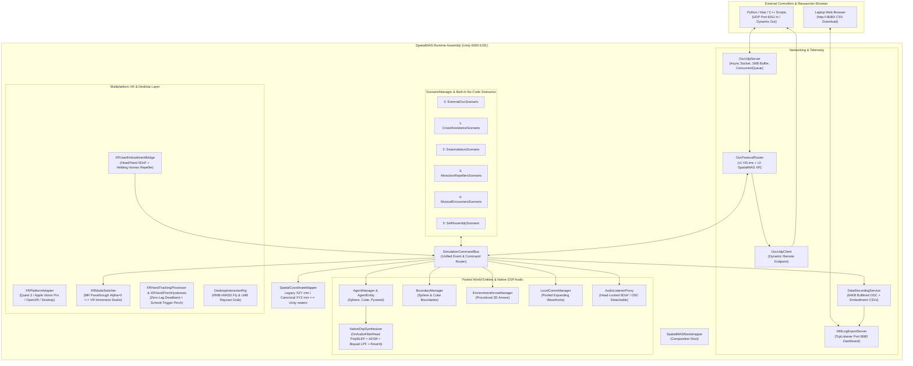

# SpatialMAS — System Architecture & Technical Design (`ARCHITECTURE.md`)

## 1. Overview & Clean-Room Mandate

**SpatialMAS** is a Mixed Reality (MR) and Virtual Reality (VR) multi-agent interaction and spatial sonification research prototype built in **Unity 6 (`6000.6.6f1`)**.

The project targets an independent XR runtime with legacy HS-ims OSC compatibility. Compatibility regressions exercise selected published signatures; commercial readiness, licensing status, and hardware support are separate validation work, not guarantees supplied by this architecture.

---

## 2. High-Level C4 Component Architecture



---

## 3. Architecture Decision Records (ADRs)

### ADR-001: Unified `SimulationCommandBus` for External OSC & Built-In Scenarios
- **Context**: In the academic prototype (`human_swarm_ims`), external OSC scripts and internal C# examples (`SelfAssembly`) were implemented in completely separate scenes and classes, duplicating agent management, audio synthesis, and logging.
- **Decision**: Route **both** external UDP OSC messages (`OscProtocolRouter`) and internal C# scenarios (`IScenarioModule`) through a single `SimulationCommandBus`.
- **Consequences**: All 5 built-in scenarios automatically benefit from spatial audio synthesis, boundary collision events, hand grabbing, and CSV recording—and external researchers can inject live OSC parameter overrides even while a standalone scenario is running on the headset.

### ADR-002: Native C# Procedural DSP Synthesizer (`NativeDspSynthesizer`) with Dual CC Compatibility
- **Context**: `CsoundUnity` in `human_swarm_ims` caused audio dropouts starting at 24 agents on desktop, blocked native Linux builds, and did not support Apple Vision Pro (`visionOS`). Furthermore, an audit of `human_swarm_examples` revealed that `README.md` documented `CC 0` for Waveform and `CC 82/83/85/17` for ADSR, whereas `CsoundBasicSynthesizer.cs` had inspector defaults `1` and `74/71/72/73`.
- **Decision**: Implement `NativeDspSynthesizer` in pure C# using `OnAudioFilterRead` (PolyBLEP oscillators, ADSR, Biquad LPF, Schroeder reverb) behind `IAgentAudioSynth`, and accept **both** primary and legacy alias CC IDs.
- **Consequences**: DSP synthesis uses C# without Csound native libraries. Unity handles 3D panning and distance rolloff; no HRTF plugin is bundled. Agent-count performance and IL2CPP/platform behavior require measurement on each target.

### ADR-003: Multiplatform XR Abstraction (`XRPlatformAdapter` + `XRModeSwitcher`)
- **Context**: SpatialMAS must run not only on Meta Quest 3, but also on **Apple Vision Pro (`visionOS`)**, generic OpenXR headsets (Pico 4 Ultra, Android XR, HTC Vive, PCVR), and Desktop laptops.
- **Decision**: Use standard Unity 6 `XROrigin`, `ARSession` / `ARCameraManager`, `XRHandSubsystem`, and `XRGrabInteractable`, isolating vendor-specific calls (such as `MetaOpenXRDisplaySubsystemExtensions`) behind `#if UNITY_ANDROID && !UNITY_EDITOR && SPATIALMAS_META_OPENXR` inside `XRPlatformAdapter.cs`.
- **Consequences**: The builder registers XR Management managers/loaders for Standalone and Android, binds headset pose actions, and creates fallback hand/controller interactors without requiring the optional XRI sample import. Runtime setup repairs older fallback scenes. The visionOS menu remains experimental until a provider, input rig, and device validation are supplied.

### ADR-004: Embedded `TcpListener` Wi-Fi HTTP Log Server (`WifiLogExportServer`)
- **Context**: Pulling recorded CSV telemetry from a Quest 3 or Apple Vision Pro via USB cables (`adb pull` or Xcode Devices window) is slow and impractical during multi-participant lab studies. Moreover, `System.Net.HttpListener` throws permission errors on Android/visionOS IL2CPP.
- **Decision**: Implement an asynchronous HTTP/1.1 server directly over `System.Net.Sockets.TcpListener` on port `8080`.
- **Consequences**: Researchers can open `http://<headset-ip>:8080/` on any laptop/tablet browser on the same Wi-Fi network and download both `osc_traffic_*.csv` and `xr_embodiment_*.csv` with one click.

---

## 4. Threading & Concurrency Model

| Thread | Component | Synchronization Mechanism |
| :--- | :--- | :--- |
| **UDP Receive Thread** | `OscUdpServer.ReceiveLoop` | Decodes packets and enqueues `OscMessage` structs into a lock-free `ConcurrentQueue<OscMessage>`. |
| **Unity Main Thread** | `OscProtocolRouter.ProcessIncomingMessages` | Drains up to 4,096 messages per `Update()` frame and dispatches to `SimulationCommandBus`. |
| **Unity Audio DSP Thread** | `NativeDspSynthesizer.OnAudioFilterRead` | Reads `volatile` synth parameters (`_targetFrequencyHz`, `_targetGain`, `_filterCutoffHz`, `_adsrStageInt`) with zero locks or heap allocations. |
| **HTTP Export Thread Pool** | `WifiLogExportServer.HandleClientAsync` | Calls `DataRecordingService.Flush()` (protected by `_lock`) and reads CSV files using `FileShare.ReadWrite`. |

## 5. Physical Coordinate and Calibration Contract

Unity world space is the authoritative data frame: X right, Y up, Z forward, left-handed; positions/dimensions are meters, velocities use meters/second, orientations are world quaternions ordered `x,y,z,w`, and durations use seconds unless labelled milliseconds. No runtime world scale or implicit origin offset exists. Mesh hierarchies may use local transforms, but APIs and recording expose world quantities. Agent uniform size is a sphere diameter, cube edge, or unit-mesh dimension; sphere boundary size is a radius. Object size changes do not move objects or change their speed, repulsion, or audio attenuation settings.

Legacy OSC positions use physical millimeters with Y/Z swapped; `/world/...` positions use physical millimeters with Unity XYZ axes. Neither adapter applies a calibration transform. `/xr/user/pose` and `/xr/hands/pose` use Unity XYZ millimeters; head quaternion and position share the same basis. The old `/xr/scale` and `/xr/origin` operations return `/error` instead of silently modifying the experiment. Old JSON scale/origin settings are ignored.

`SpatialCalibrationReference` is a separate unit-scale frame, never the parent of the simulation or participant. Its marker can be shown/hidden, unlocked, translated, rotated, and locked through desktop/XR controls or OSC. Hiding graphics does not deactivate its pose or history. A reference change increments its revision and is recorded without transforming existing world poses. Defaults: reference at world zero/identity, visible, locked.

For a reference pose `(t_ref, q_ref)` in Unity world coordinates:

```text
p_reference_m = inverse(q_ref) * (p_world_m - t_ref)
q_reference   = inverse(q_ref) * q_world
```

Both sides of these formulas use Unity axes. An external system with different axes/handedness requires a documented basis adapter; millimeters require a factor of 1000 at that boundary. To establish spatial alignment, observe the same physical reference frame in Unity and the external system. An arbitrarily placed virtual marker does not automatically calibrate a motion-capture system. This spatial reference does not synchronize external clocks.

Scenario placement is an ordinary world-meter spawn center. Compact/RoomScale layouts contain explicit physical dimensions and model defaults. Changing the next center/layout leaves the current scene unchanged and takes effect on the next load/reset. There is no multiplication of the participant's physical interaction properties by a scenario layout.

## 6. Recording Schema Version 2

Each session creates five CSVs and one JSON sharing a unique session ID. Files use `CreateNew`; rapid restart cannot truncate an earlier session. Every session starts with a calibration snapshot; its first sampled frame records the current scenario identity/layout/centers/pause state and tracking frame, including after a stop/start within one frame.

| File prefix | Contents |
| --- | --- |
| `osc_traffic_` | Raw inbound/outbound protocol messages; interpretation follows each endpoint's units and axis convention. |
| `xr_embodiment_` | World head/hand poses, full quaternions, tracking flags, desktop/XR source, physical repeller settings, active scenario/layout/center, reference ID/revision, tracking revision, and XR-origin pose/scale. |
| `object_state_` | Actual sampled agents, boundaries, and active arrows: kind/ID, world pose, dimensions, movement mode, grabbed/interactable flags, and calibration/tracking revisions. |
| `calibration_` | Initial reference snapshot and every reference pose/visibility/lock revision. |
| `session_events_` | Recording lifecycle, scenario states/parameters/presets, calibration changes, and tracking-frame changes. |
| `session_metadata_` (`.json`) | Schema version, coordinate/unit/rotation conventions, initial reference, configuration snapshot, file inventory, and sampling semantics. |

Join participant and object rows by `(SessionId, SampleId)`. Their `TimestampISO`, `ElapsedMs`, and `Frame` are shared within a sample. `ElapsedMs` is monotonic session time; UTC provides a wall-clock label. Sampling occurs after simulation updates in LateUpdate, targets the configured frequency, and emits at most one observation per frame. These are Unity observations, not hardware acquisition timestamps or uniformly spaced synthetic samples. Estimate motion using actual timestamps.

Object dimensions are the mesh's local bounds multiplied by its world scale, measured along the object's own axes; boundary dimensions are full extents/diameters. They are not rotated world-axis AABBs. Text floats use round-trip precision; raw Unity floats remain the source precision.

Untracked hands may contain fallback poses: exclude rows with their tracked flag false from measured-hand analyses. `HeadSource=DesktopCamera` identifies simulation; `XRUntracked` indicates unavailable head tracking. `CoordinatesValid` checks the unit-scale XR hierarchy; it does not certify tracking accuracy or external calibration. Non-unit XR scale is recorded and flagged rather than silently normalized. Origin transform changes and provider `trackingOriginUpdated` events increment the tracking revision. Segment/revalidate external calibration across tracking-origin changes.

Config JSON in metadata is a configuration snapshot, while sampled active scenario state and subsequent events describe runtime changes. The initial scenario event does not snapshot every live behavior parameter or a preset applied before recording; parameter/preset events capture changes made during recording. Start recording before applying experimental settings when their history is needed. Raw world data is retained; reference-relative coordinates can be derived later using the matching reference revision. Old recordings are not converted and must retain their original schema interpretation.

The proxy owns the active `AudioListener`; head lock copies the camera pose and detached control accepts an explicit world pose. Calibration changes affect neither listening pose nor audio parameters. Buffered file writes are synchronized, not performed on a dedicated asynchronous writer thread.
