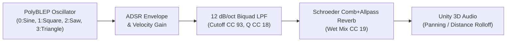

# SpatialMAS — Built-In Scenarios & Procedural DSP Audio (`SCENARIOS_AND_AUDIO.md`)

## 1. Native C# Procedural DSP Synthesizer (`NativeDspSynthesizer.cs`)

Each agent in SpatialMAS carries a dedicated 3D `AudioSource` (`spatialBlend = 1.0`) driven by [`NativeDspSynthesizer.cs`](../Assets/_SpatialMAS/Runtime/Audio/NativeDspSynthesizer.cs) inside Unity's real-time audio thread (`OnAudioFilterRead`).

### Signal Chain

1. **PolyBLEP Anti-Aliasing**: Square and Sawtooth waveforms apply Polynomial Bandlimited Step (`PolyBlep`) correction around phase discontinuities ($t = 0$ and $t = 0.5$) to eliminate harsh digital aliasing at higher MIDI notes.
2. **Hybrid Note-On & Continuous Drone Mode**:
   - Standard MIDI scripts trigger `NoteOn (1)` and `NoteOff (0)` via `/agents/audio/synth/note`.
   - Continuous scripts set `CC 2` (Frequency Hz) and `CC 16` (Gain) without `NoteOn`. These may arrive in either order. Positive gain starts/resumes the tone after frequency control is selected; a note message returns the voice to note-driven ADSR behavior.

The proxy owns the single active `AudioListener`. Head lock follows the physical camera; unlocking allows OSC position/rotation changes to affect the actual listening pose. Unity's default 3D panning/rolloff is configured; an HRTF spatializer is not bundled.

---

## 2. Built-In No-Code Interactive Scenarios

### Scenario 0: External OSC Controller Mode (`ExternalOscScenario.cs`)
Pure transceiver mode on UDP port `6011` for external Python, Cycling '74 Max, or C++ scripts. Switching from a built-in scenario preserves its agents and unmutes them for external control; reset clears them.

### Scenario 1: Crowd Navigation & Human Avoidance (`CrowdAvoidanceScenario.cs`)
Implements the behavioral psychology & architectural crowd navigation use case from the *SpatialMAS* Grant Proposal:
- **Kinematics**: Combines Reynolds Boids ($\mathbf{F}_{\text{sep}} + \mathbf{F}_{\text{align}} + \mathbf{F}_{\text{coh}}$) with **Helbing's Social Force Model** around the XR user's physical head (`MainCamera`) and hands:
  $$\mathbf{F}_{\text{human}, i} = A_{\text{rep}} \exp\!\left(\frac{R_{\text{personal}} - \|\mathbf{x}_i - \mathbf{x}_{\text{user}}\|}{0.35 R_{\text{personal}}}\right) \frac{\mathbf{x}_i - \mathbf{x}_{\text{user}}}{\|\mathbf{x}_i - \mathbf{x}_{\text{user}}\|}$$
- **Sonification**: Proximity to the human participant shifts each agent's color from Calm Teal to Alert Coral, opens its Biquad LPF cutoff (`900 Hz` $\to$ `6500 Hz`), and accelerates rhythmic pulses quantized to a D-minor 9th chord.

### Scenario 2: 3D Swarmalators (`SwarmalatorsScenario.cs`)
Couples 3D spatial attraction/repulsion ($J$) and Kuramoto phase synchronization ($K$):
$$\dot{\mathbf{x}}_i = \frac{1}{N-1} \sum_{j \neq i} \left[ \frac{\mathbf{x}_j - \mathbf{x}_i}{\|\mathbf{x}_j - \mathbf{x}_i\|} \big(1 + J \cos(\theta_j - \theta_i)\big) - \frac{\mathbf{x}_j - \mathbf{x}_i}{\|\mathbf{x}_j - \mathbf{x}_i\|^3} \right]$$
$$\dot{\theta}_i = \omega_i + \frac{K}{N-1} \sum_{j \neq i} \frac{\sin(\theta_j - \theta_i)}{\|\mathbf{x}_j - \mathbf{x}_i\|}$$
Includes 5 macro-state presets (*Static Sync*, *Static Async*, *Static Phase Wave*, *Splintered Phase Wave*, *Active Phase Wave*) and interactive user-grabbable cube swarmalators.

### Scenario 3: Orbital Attractors & Repellers (`AttractorsRepellersScenario.cs`)
Autonomous spheres orbit in spherical coordinates $(r, \theta, \varphi)$ around user-grabbable **Cyan Attractor Cubes**. Entering a **Red Repeller Cube** field reverses orbital velocity once, with exit hysteresis before another reversal. Speed parameters and presets immediately rescale existing angular velocities. Agents periodically broadcast their orbital phase via expanding `/agents/localcomm` wavefront spheres.

### Scenario 4: Musical Encounters (`MusicalEncountersScenario.cs`)
Autonomous agents bounce elastically inside a translucent spherical boundary. Whenever two agents (or a user-held interactive cube) come within `detectionRadius`, both flash warm gold and trigger a C-Major chord note quantized by radial distance from the boundary center ($r / R_{\text{boundary}}$).

Speed parameters and presets immediately rescale existing velocities. Arena calibration changes rebase active scenario positions, sizes, and velocity caches together.

### Scenario 5: Self-Assembly (`SelfAssemblyScenario.cs`)
Cubic agents with 6 orthogonal face connection slots (`+X, -X, +Z, -Z, +Y, -Y`):
- **8-State Machine**: `Wandering` (Orange) $\to$ `WanderingAndDetecting` (Cyan) $\to$ `ToJoin` (Green) $\to$ `Joined` (Blue), plus interactive states `WanderingWithUser` (White), `JoinedWithUser` (Purple), and `Frozen` (Magenta).
- **Coupled Musical Phasors**: When cubes dock at $90^\circ$ orthogonal face slots, their internal musical phasors ($\psi \in [0, 1)$) synchronize to the root structure, stepping sequentially through connected face slots to play polyrhythmic pentatonic melodies whose Attack/Release times grow lusher as the structure size increases.

Docking applies cube rotations to the visible entities. Detachment rebuilds parent/root membership for each remaining connected structure so separated cubes stop following old parents.
